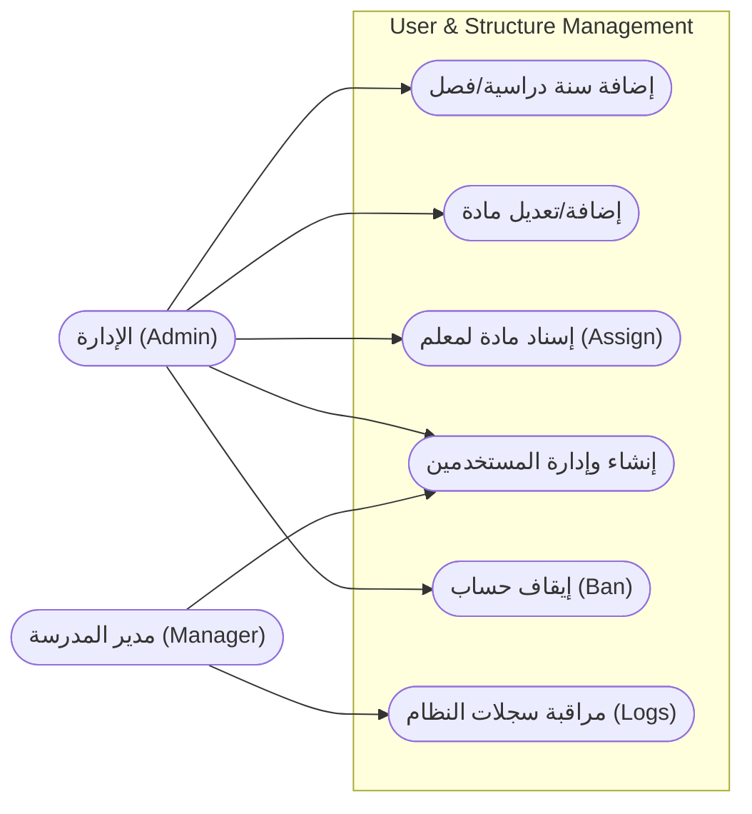
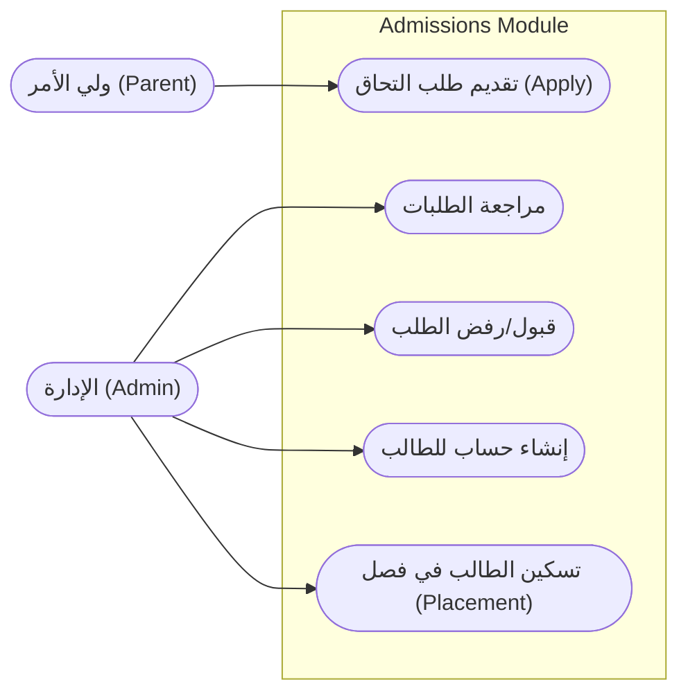
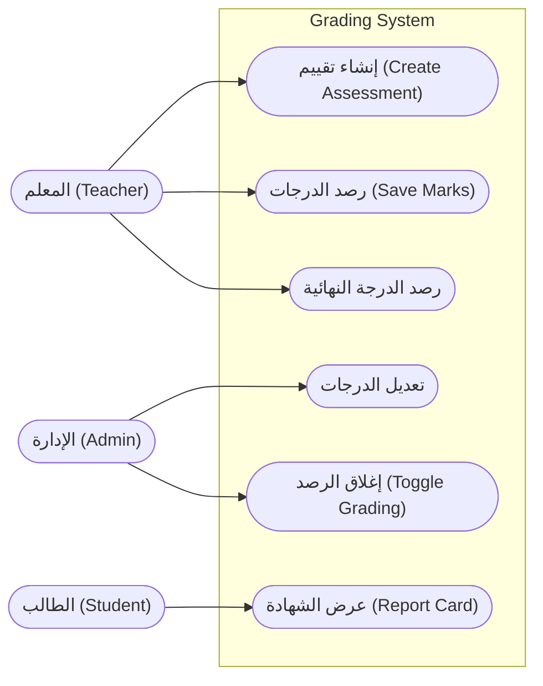
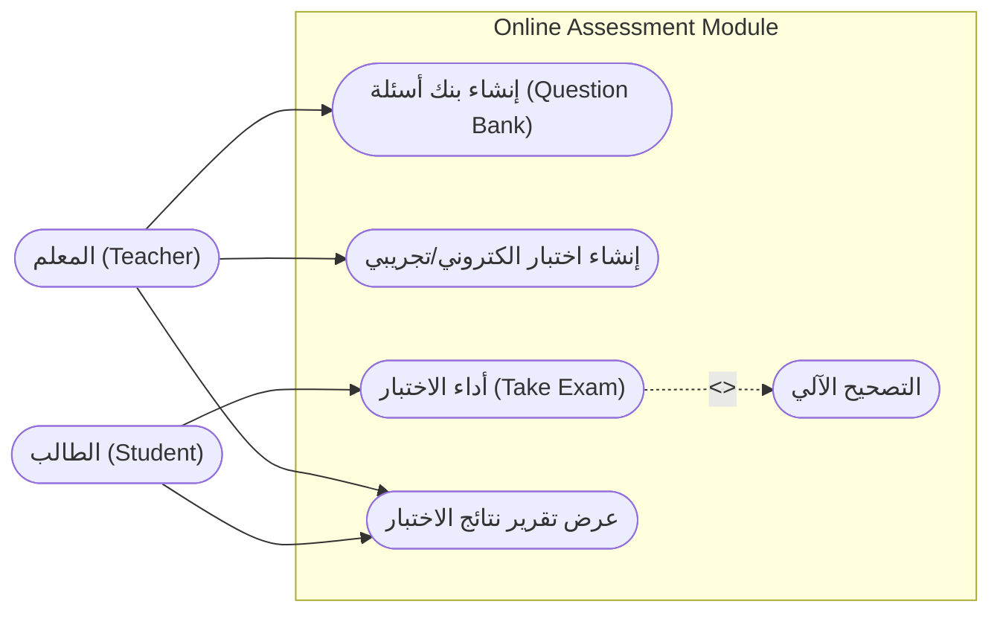
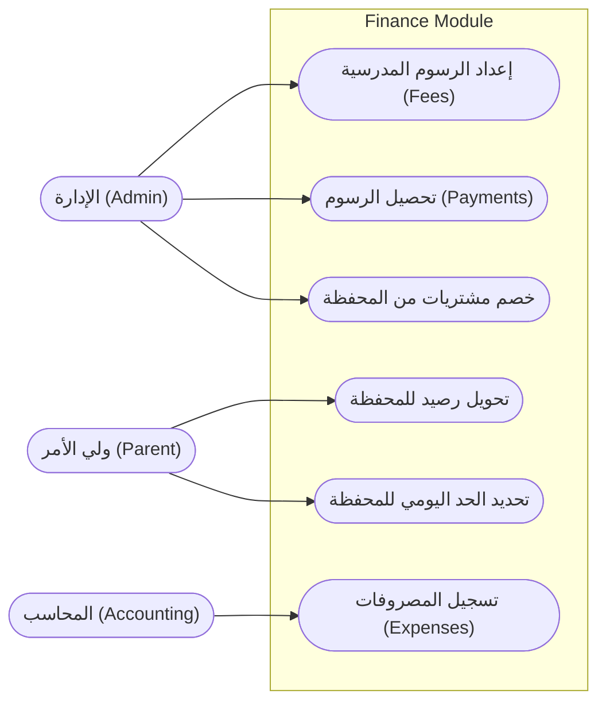
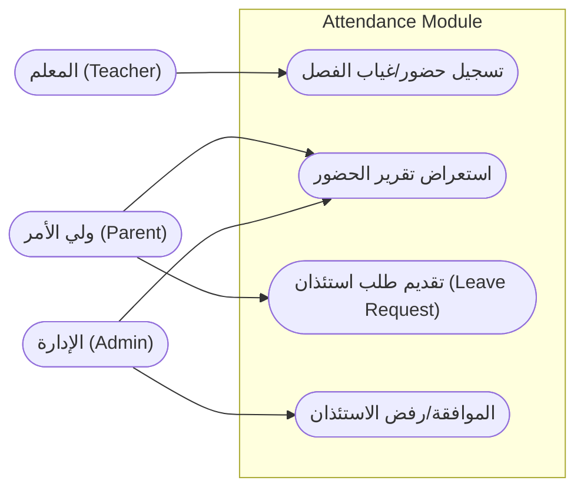
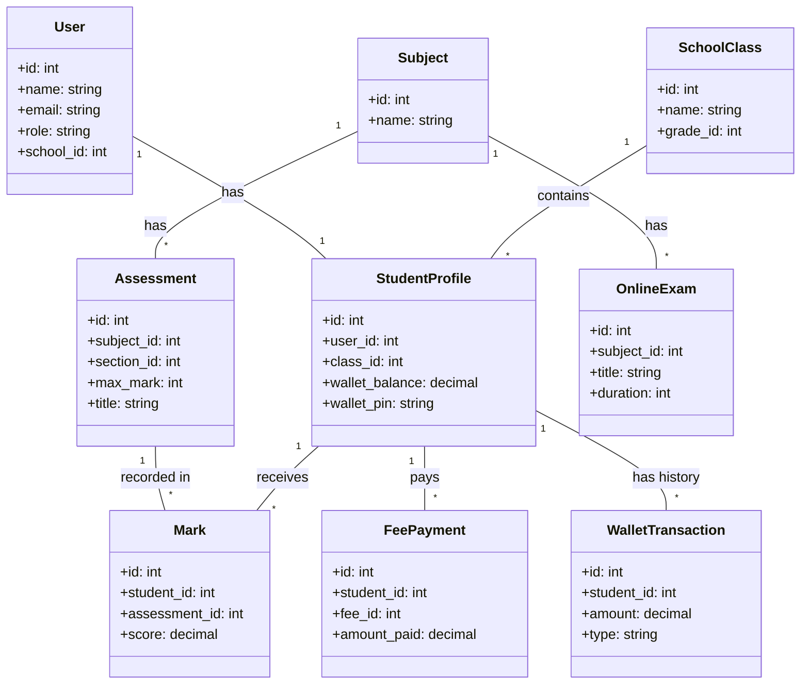
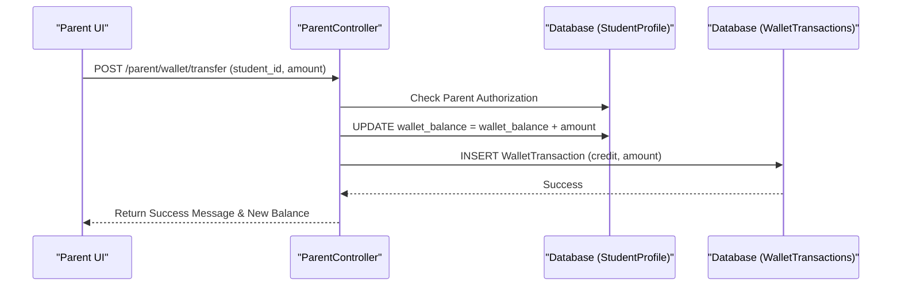
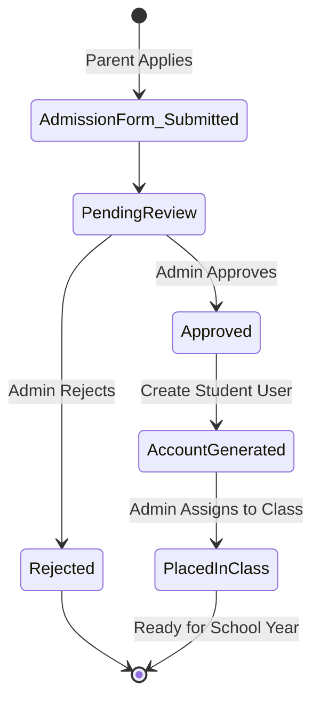

# توثيق نظام Smart School الشامل (Comprehensive Documentation)

---

# 1. تحليل النظام ونظرة عامة (System Analysis & Overview)

## 1.1 رؤية المشروع (Project Vision)
نظام **Smart School** هو نظام سحابي متكامل لإدارة المدارس (SaaS)، يهدف إلى رقمنة جميع العمليات الإدارية، الأكاديمية، والمالية في المؤسسات التعليمية. يوفر النظام بيئة تواصل فعالة بين كافة أطراف العملية التعليمية (إدارة، معلمين، طلاب، أولياء أمور) من خلال لوحات تحكم مخصصة لكل فئة، مع التركيز على سهولة الاستخدام والموثوقية وتوفير أدوات تقييم ومتابعة شاملة.

## 1.2 أهداف النظام (System Objectives)
1. **أتمتة المهام الإدارية**: تقليل العمل اليدوي في إدارة القبول، التسجيل، ترحيل الطلاب، والهيكل الأكاديمي.
2. **إدارة أكاديمية متقدمة**: توفير أدوات لإدارة الجداول الدراسية آلياً، الواجبات، الاختبارات الإلكترونية، ورصد الدرجات وتقييم الطلاب بمرونة.
3. **التواصل الفعال**: نظام مراسلة داخلي متكامل وربط أولياء الأمور بمتابعة حية لنتائج أبنائهم وسلوكهم وحضورهم.
4. **نظام مالي ومحاسبي**: إدارة رسوم الطلاب، المدفوعات، المحفظة الإلكترونية للطالب، والمصروفات المدرسية.
5. **التقارير التحليلية**: استخراج تقارير شاملة عن أداء الطلاب، المعلمين، الحضور، والجانب المالي لمتخذي القرار.

## 1.3 الفئات المستهدفة / أدوار المستخدمين (User Roles)
يتضمن النظام 7 أدوار رئيسية بصلاحيات مختلفة:
1. **مدير النظام (Super Admin)**: يدير النظام كاملاً، يضيف المدارس (العملاء)، ويدير تراخيصها.
2. **مدير المدرسة (School Manager)**: المالك أو المدير العام للمدرسة. يراقب أداء المدرسة، يدير سجلات النظام (System Logs)، ويعين صلاحيات الإداريين.
3. **الإدارة (Admin)**: المسؤول الإداري والأكاديمي (مثل وكيل المدرسة). يقوم بضبط الهيكل الدراسي (صفوف، فصول، مواد)، توزيع الجداول، رصد الرسوم، وإدارة المستخدمين والطلاب.
4. **المعلم (Teacher)**: يدير فصوله المسندة إليه، يسجل الغياب، يرصد الدرجات، يرفع المواد التعليمية، وينشئ الاختبارات والواجبات.
5. **الطالب (Student)**: يطلع على جدوله، درجاته، غيابه، يحل الواجبات والاختبارات الإلكترونية (Quizzes/Online Exams)، ويتواصل مع معلميه.
6. **ولي الأمر (Parent)**: يتابع جميع أبنائه المسجلين في المدرسة من شاشة واحدة، يطلع على تقارير الأداء، الغياب، ويدفع الرسوم، ويدير المحفظة الإلكترونية للطالب.
7. **المحاسب (Accounting)**: (قد يكون مدمجاً مع Admin) يدير المصروفات والتقارير المالية.

## 1.4 الوحدات الرئيسية للنظام (Core Modules)
1. **وحدة الهيكل التنظيمي والأكاديمي**: (السنوات الدراسية، الفصول، المواد، توزيع المواد على المعلمين).
2. **وحدة إدارة شؤون الطلاب والقبول**: (تسجيل طلاب جدد، ترحيل الطلاب ونهاية العام، تسكين الطلاب في الفصول).
3. **وحدة التقييم والاختبارات**: (بناء الاختبارات الإلكترونية، بنك الأسئلة، الاختبارات التجريبية، التقييمات المستمرة، الشهادات النهائية).
4. **وحدة الحضور والجدولة**: (توليد الجداول تلقائياً، تبديل الحصص، رصد غياب الطلاب).
5. **وحدة المالية والمحاسبة**: (تحديد الرسوم، تحصيل المدفوعات، المحفظة، تسجيل المصروفات المدرسية).
6. **وحدة التواصل ومركز الرسائل**: (شات داخلي، إشعارات أولياء الأمور، طلبات الاستئذان).
7. **وحدة التقارير والإحصاءات**: (لوحات قياس ذكية، تقارير أداء فردية وجماعية، تقارير مالية).

---

# 2. المتطلبات الوظيفية وغير الوظيفية (Functional & Non-Functional Requirements)

تم تفصيل المتطلبات الوظيفية لكل وحدة عمل (Module) بدقة لتشمل المدخلات والمخرجات المتوقعة، مع إبراز المتطلبات غير الوظيفية (NFRs) بالتفصيل.

## 2.1 المتطلبات الوظيفية (Functional Requirements)

### أ. وحدة الهيكل الأكاديمي وإدارة المستخدمين (Academic Structure & User Management)
**المستخدمون (Actors)**: Admin, School Manager, Super Admin
* **FR-1.1 إدارة السنوات الدراسية والفصول (Grades & Classes)**:
  * يجب أن يوفر النظام واجهة للإدارة (Admin) لإنشاء السنوات الدراسية (Grades) وربطها بالفصول (Classes).
  * يجب إتاحة إمكانية تعديل وحذف الفصول.
* **FR-1.2 إدارة المواد الدراسية (Subject Management)**:
  * يجب أن يتمكن الـ Admin من إضافة المواد الدراسية (Subjects) وتحديد طبيعتها وتوزيع درجاتها (Grade Distribution).
  * يجب ربط كل مادة بصف معين وبمعلم محدد (Teacher Assignment).
* **FR-1.3 إدارة الحسابات (Account Management)**:
  * يجب أن يدعم النظام إنشاء، تعديل، وحذف حسابات لـ (Teachers, Students, Parents).
  * يجب توفير خاصية حظر الحسابات (Toggle Ban) وإعادة تعيين كلمة المرور (Reset Password).
* **FR-1.4 إعدادات العام الدراسي (Academic Year)**:
  * يجب على الـ Admin إمكانية قفل وفتح الرصد (Toggle Grading)، وإغلاق العام الدراسي (Close Year).

### ب. وحدة القبول وشؤون الطلاب (Admission & Student Affairs)
**المستخدمون (Actors)**: Admin, Parent, Student
* **FR-2.1 طلبات القبول (Admissions)**:
  * يجب أن يتمكن ولي الأمر (Parent) من تعبئة نموذج طلب التحاق (Admission Form) لطالب جديد.
  * يجب أن يستقبل الـ Admin الطلب ويقوم بتغيير حالته (Status: Pending, Approved, Rejected).
* **FR-2.2 تسكين وترحيل الطلاب (Placement & Promotion)**:
  * يجب أن يتمكن الـ Admin من تسكين الطلاب غير الموزعين (Unassigned Students) في فصولهم.
  * يجب أن يوفر النظام ميزة الترحيل الآلي للطلاب الناجحين للعام التالي (Execute Promotion) أو إبقائهم في حالة الرسوب (Retained).
* **FR-2.3 طلبات الاستئذان (Leave Requests)**:
  * يجب أن يتيح النظام لولي الأمر طلب إجازة للطالب (Leave Request).
  * يقوم الـ Admin بمراجعة الطلب واعتماده.

### ج. وحدة التقييم ورصد الدرجات (Assessment & Grading)
**المستخدمون (Actors)**: Teacher, Admin, Student, Parent
* **FR-3.1 إنشاء التقييمات (Create Assessments)**:
  * يجب أن يقوم المعلم (Teacher) بإنشاء تقييمات (Assessments) مخصصة لمواده والفصول المسندة إليه.
* **FR-3.2 رصد الدرجات (Marks Grading)**:
  * يجب أن يتمكن المعلم من رصد درجات الطلاب (Save Marks) لكل تقييم، ورصد درجة الامتحان النهائي (Final Grades).
  * يجب أن يسمح النظام للـ Admin بتعديل الدرجات بصلاحيات إدارية إذا دعت الحاجة.
* **FR-3.3 الشهادات والتقارير (Report Cards)**:
  * يجب أن يقوم النظام تلقائياً بتجميع الدرجات وعرض الشهادة (Report Card) للطالب وولي أمره.

### د. وحدة الاختبارات الإلكترونية وبنك الأسئلة (Online Exams & Quizzes)
**المستخدمون (Actors)**: Teacher, Student
* **FR-4.1 إدارة بنك الأسئلة (Question Bank)**:
  * يجب على المعلم إمكانية إنشاء وتعديل أسئلة (Questions) متنوعة.
* **FR-4.2 الاختبارات الإلكترونية (Online Exams & Quizzes)**:
  * يجب أن يستطيع المعلم إنشاء اختبار الكتروني (Online Exam) أو كويز تجريبي بمدة زمنية محددة.
  * يجب أن يتمكن الطالب من أداء الاختبار (Take Exam) وتقديم الإجابات (Submit) قبل انتهاء الوقت.
  * يجب أن يتم التصحيح الآلي للاختبارات الموضوعية وعرض النتائج.

### هـ. وحدة المالية والمحفظة (Financials & Wallet)
**المستخدمون (Actors)**: Admin, Parent, Student, Accounting
* **FR-5.1 إدارة الرسوم (Fees Management)**:
  * يجب أن يتيح النظام للإدارة (Admin) تحديد الرسوم المدرسية (Fees) للطلاب.
  * يجب تسجيل الدفعات (Fee Payments) واستخراج إيصالات الدفع (Print Receipt).
* **FR-5.2 المحفظة الإلكترونية (E-Wallet)**:
  * يجب أن يتوفر لكل طالب محفظة إلكترونية (Wallet Balance).
  * يحق لولي الأمر تحويل المبالغ للمحفظة (Transfer Wallet)، تعيين حد إنفاق يومي (Daily Limit)، وتغيير الرقم السري (PIN).
  * يمكن للإدارة سحب رصيد (Purchase) من المحفظة مقابل خدمات المدرسة (كالمقصف).
* **FR-5.3 المصروفات (Expenses)**:
  * يجب أن تتوفر شاشة لتسجيل المصروفات اليومية للمدرسة (Store Expense) لاستخراج تقرير الأرباح والخسائر (Profit/Loss Report).

### و. وحدة الحضور والتواصل (Attendance & Communication)
**المستخدمون (Actors)**: Teacher, Parent, Admin, All Users
* **FR-6.1 رصد الحضور (Attendance Tracking)**:
  * يجب على المعلم تسجيل الحضور والغياب (Store Attendance) للطلاب في حصصه.
  * يجب أن يظهر إشعار فوري لولي الأمر والإدارة بحالة الغياب.
* **FR-6.2 المراسلة الفورية (Real-time Chat)**:
  * يجب توفير نظام مراسلة داخلي (Chat/Messages) يسمح بتواصل آمن بين الطالب والمعلم، أو بين الإدارة وأولياء الأمور.

## 2.2 المتطلبات غير الوظيفية (Non-Functional Requirements)

* **NFR-1 الأمان والصلاحيات (Security & Access Control)**
  * **Role-Based Access Control (RBAC)**: يجب ألا يتمكن أي مستخدم من الوصول إلى مسارات (Routes) لا تخصه بناءً على الـ Role الخاص به (يتم تطبيق Middleware مثل `role:admin`, `role:teacher`).
  * **تشفير البيانات (Encryption)**: يجب تشفير كلمات المرور (Passwords) في قاعدة البيانات (Bcrypt).
  * **أمان الـ API**: استخدام توكن (Tokens) مثل `Laravel Sanctum` في حال وجود تطبيق جوال للتحقق من هوية المستخدم.

* **NFR-2 الأداء (Performance)**
  * **زمن الاستجابة (Response Time)**: يجب ألا يتجاوز زمن تحميل أي صفحة 2 ثانية في الحالات العادية.
  * **تحمل الضغط (Scalability)**: يجب أن يتحمل النظام طلبات متزامنة (Concurrent Requests) عالية خاصة أثناء أداء الطلاب للاختبارات الإلكترونية (Online Exams). ينصح بتفعيل التخزين المؤقت (Cache) لبيانات الأسئلة.

* **NFR-3 الموثوقية وقابلية الاسترداد (Reliability & Recoverability)**
  * **النسخ الاحتياطي (Backup)**: يجب أخذ نسخة احتياطية (Daily Backup) من قاعدة البيانات (Database) يومياً لضمان عدم ضياع بيانات رصد الدرجات أو الدفعات المالية.
  * **تكامل البيانات (Data Integrity)**: استخدام المعاملات البرمجية (Database Transactions) عند تنفيذ العمليات المالية (مثل التحويل للمحفظة) لضمان عدم خصم مبالغ دون تسجيلها كإيرادات.

* **NFR-4 قابلية الاستخدام وتجربة المستخدم (Usability & UX)**
  * **التجاوب (Responsiveness)**: يجب أن يكون التصميم متجاوباً ليعمل بشكل ممتاز على الهواتف المحمولة (Mobile-friendly)، خصوصاً لوحات تحكم أولياء الأمور والطلاب.
  * **متعدد اللغات (Localization)**: يجب دعم الواجهات باللغتين العربية والإنجليزية (RTL / LTR support).

* **NFR-5 قابلية الصيانة وتتبع الأخطاء (Maintainability)**
  * **System Logs**: يجب تسجيل نشاطات مدراء النظام والعمليات الحساسة (Audit Trails) في سجل النظام لمراجعتها من قِبل الـ School Manager.

---

# 3. مخططات حالات الاستخدام التفصيلية والمخططات الأخرى (UML Diagrams)

توضيح لجميع عمليات النظام مفصلة بمخططات حالات الاستخدام (Use Case Diagrams - UCD) لكل وحدة منفصلة، بالإضافة إلى مخططات التتابع (Sequence) ومخطط الفئات (Class Diagram).

## 3.1 مخططات حالات الاستخدام لكل عملية (UCD per Process)

### أ. UCD: الهيكل الأكاديمي وإدارة المستخدمين (Academic & User Management)

### ب. UCD: وحدة القبول والتسجيل (Admission & Enrollment)

### ج. UCD: التقييم ورصد الدرجات (Assessment & Grading)

### د. UCD: الاختبارات الإلكترونية (Online Exams & Quizzes)

### هـ. UCD: المالية والمحفظة (Financials & Wallet)

### و. UCD: الحضور والغياب (Attendance)

## 3.2 مخطط الفئات المعماري (Class Diagram - Database Entities)
يعكس بنية الجداول في قاعدة البيانات استناداً للملفات (Models & Migrations).

## 3.3 مخططات التتابع والنشاط (Sequence & Activity Diagrams)

### أ. مخطط تتابع دورة حياة المحفظة (Wallet Transaction Sequence)

### ب. مخطط النشاط لدورة القبول (Admission Activity Diagram)

